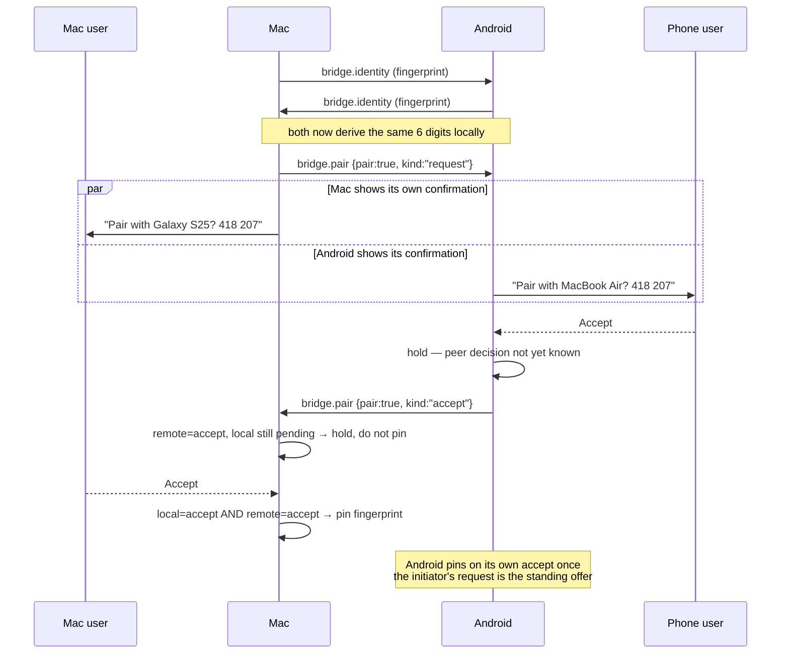

## Context

See `proposal.md` — Why for the motivation and the verified evidence. What shapes the approach
here, beyond that:

- **Identity already carries the fingerprint.** `bridge.identity` includes
  `certificateFingerprint` (`protocol/identity`, "Identity includes certificate fingerprint"),
  and both sides exchange identity before any `bridge.pair` packet. So both fingerprints are in
  hand before pairing starts, and the six-digit code needs **no new packet type and no protocol
  version bump**.
- **Pairing is currently one-sided.** The flow is request → accept. Confirmation on *both*
  screens means a local decision and a remote decision must both land before anything pins, in
  either order.
- **Crossed initiation is already solved and must survive.** Both sides can send a request at
  once; `PairingManager.yieldsOnCrossedRequest` resolves it by comparing `deviceId`, on both
  platforms. Adding a confirmation gate must not reintroduce the half-paired state that logic
  exists to prevent.
- **`PayloadServer`/`PayloadClient` already wrap a real socket on both platforms.** Android uses
  `java.net.ServerSocket`; the Mac uses `NWListener(using: .tcp)` / `NWConnection`. Both have a
  first-class TLS story. This is why the payload path is the cheap one.
- **The Mac connects on discovery.** `centralManager(_:didDiscover:...)` leads to
  `centralManager.connect(...)` with no user step. The picker goes exactly there.

## Goals / Non-Goals

**Goals:**

- One trust decision point per platform that every packet passes through, so "is this peer
  allowed?" is answered in one place rather than at each call site.
- A six-digit derivation that is byte-identical across Swift and Kotlin, proven by shared vectors
  rather than by reading both implementations.
- Confidentiality for file payloads, which is where bytes actually cross a network.
- No new packet types, no protocol version bump, and no forced re-pair for devices already paired.

**Non-Goals:**

- Mutual TLS on the L2CAP control channel. Ruled out with its reasoning in the
  `security/certificate-pinning` REMOVED delta.
- Replacing the self-signed certificate model, the trust store format, or the `bridge.pair`
  packet shape.
- Protecting against an attacker with physical possession of an unlocked device. The pin lives in
  the Keychain and Android Keystore; an unlocked device is already the user's device.
- Rate-limiting, lockout, or audit logging of failed pair attempts. Worth having, not this change.

## Decisions

### 1. The code is derived, never transmitted

Both ends compute `code = SHA256(sorted([fpA, fpB]).join("")) → first 4 bytes big-endian → mod
1e6 → zero-pad 6`, exactly as `protocol/pairing` specifies.

*Why derived, not transmitted:* a transmitted code proves nothing — an attacker in the middle
relays it. The code's entire value is that it is computed independently from inputs an attacker
cannot control on both sides at once. Sorting makes it order-independent so neither side needs to
know who initiated.

*Alternative rejected:* a random nonce from the initiator, displayed on both. Simpler, and
useless — it authenticates nothing, because the man in the middle forwards the nonce unchanged.

*First four bytes, not a modulo over the whole digest:* truncation is uniform enough here and is
trivially reproducible in both languages. 2^32 mod 10^6 leaves a bias under 0.03%, far below
anything that matters against a 1-in-10^6 guess.

### 2. Pairing becomes a two-sided gate with a held remote decision

Each side tracks its own user's answer and the peer's answer separately, and pins only when both
are "accept". Either order is valid.



*Why hold rather than pin-on-arrival:* pinning when the peer's accept arrives is exactly the
current bug — `handlePairAcceptOrRequest` stages a confirmation and then accepts on the next
line. A held decision makes "the user has not answered yet" a real state instead of an
instantaneous one.

*Decline is terminal and symmetric:* a decline on either side sends `pair:false`, clears both
held decisions, and pins nothing — satisfying "declining on either side leaves both trust stores
unchanged".

*Crossed requests:* `yieldsOnCrossedRequest` still picks the initiator. The yielding side's user
still confirms; yielding decides who sends `accept`, not whether a human is asked.

*The 30-second timeout stays*, but applies to the **peer's** decision only. A local prompt the
user has not answered does not expire — BR-2 established that a silently expiring prompt is a dead
end, and that reasoning is unchanged.

### 3. One trust gate per platform, applied before dispatch

Replace the inline condition in `L2capServer.handlePacket` with a single function answering
"may this peer send this packet type?", consulted for every packet before dispatch:

```
allow(packetType) =
    packetType in {bridge.identity, bridge.pair}     → true
    peer identity not received this session          → false
    trust store unreadable or throws                 → false
    pinned fingerprint for peerDeviceId absent       → false
    pinned fingerprint != presented fingerprint      → false
    otherwise                                        → true
```

*Why a function and not inline conditions:* the current bug is structural — the check is nested
inside `if (peerDeviceId != null && ...)`, so the most dangerous case (nothing known about the
peer) is the one case that skips it. Default-deny has to be the shape of the code, not a branch
inside it. The three fail-opens (`catch (_: IllegalStateException) {}`, the null-fingerprint
accept in `BridgeTrustManager`, the missing pre-identity check) all collapse into this one gate.

*`bridge.ping` is not exempt.* Answering a ping confirms a live Bridge endpoint to an
unidentified peer. It costs nothing to withhold.

### 4. Payload TLS uses each platform's native story; no shared abstraction

| | Android | Mac |
|---|---|---|
| Server | `createSSLContext(...).serverSocketFactory` over the existing `ServerSocket` | `NWParameters(tls: opts, tcp: .init())` on `NWListener` |
| Client | `createSSLContext(...).socketFactory` | same `NWParameters` on `NWConnection` |
| Pinning | `BridgeTrustManager(expectedFingerprint:)` — already written and correct when given a fingerprint | `sec_protocol_options_set_verify_block` comparing the SHA-256 of the leaf |
| Client auth | `needClientAuth = true` on the server socket | `sec_protocol_options_set_peer_authentication_required(opts, true)` |

*Why no shared wrapper:* a cross-platform TLS abstraction over two unrelated native APIs buys
nothing — the two implementations share no code, only a test vector. The shared artefact that
matters is the pinning *behaviour*, and `file-transfer/payload-channel` already specifies it.

*`BridgeTrustManager`'s null-fingerprint branch becomes a rejection* rather than being deleted,
so a caller that forgets to pass a pin fails closed instead of failing to compile into something
permissive.

### 5. The L2CAP secure listen is spiked before anything depends on it

Switching `listenUsingInsecureL2capChannel()` → `listenUsingL2capChannel()` requires the Mac to
be bonded with the phone. Core Bluetooth exposes no explicit bond API; bonding is triggered
implicitly when a central accesses a characteristic requiring encryption.

This is sequenced as the **first** task, and nothing else depends on its outcome. Two outcomes,
both acceptable:

- **Bonding established** → the control channel is link-layer encrypted. If macOS surfaces its
  own numeric-comparison prompt during bonding, that is a second, OS-level confirmation. It does
  **not** replace Bridge's six-digit code: the OS code authenticates the Bluetooth link, Bridge's
  authenticates the certificates that the payload TLS actually pins.
- **Bonding not reachable** → revert to the insecure listen, and the README, PRD and
  `security/certificate-pinning` say the control channel is unencrypted. This is already written
  into the spec as a documented scenario, not a failure.

Either way the rest of the change lands unchanged. That is the point of spiking it first.

### 6. The device picker gates connect, not scan

Discovery keeps running and keeps feeding the scan watchdog (BR-13's work is untouched). What
changes is that `didDiscover` routes to a connect only when the peripheral is the paired device;
otherwise it accumulates into an observable list of (name, RSSI, peripheral, last-seen).

*Why not stop scanning while the picker is open:* the picker must show current signal strength
and drop devices that walk away, and BR-13's watchdog treats a scan that discovers nothing as
broken. Stopping the scan would fight both.

*Entries age out* on a last-seen timer rather than being removed on the first missed
advertisement, so a device does not flicker out of the list between advertising intervals.

### 7. Line cap: 256 KB, connection closed on breach

The largest legitimate control packet is a notification with a long body; the protocol routes
anything over 10 KB out of band (project convention). 256 KB is ~25× the out-of-band threshold
and small enough that a hostile peer cannot grow memory meaningfully.

*Close rather than skip-to-next-newline:* a peer sending an oversized line is either broken or
hostile, and resynchronising a stream from an attacker-chosen offset is a parsing problem nobody
needs. The link reconnects on its own.

## Risks / Trade-offs

- **Secure L2CAP may not be reachable between a Galaxy S25 and a MacBook Air** → Spiked first,
  nothing depends on it, and the documented-plaintext fallback is already a spec scenario.
- **Removing auto-accept changes the out-of-box path from zero taps to two** → Intended, and the
  whole point of BR-5. Risk is that first-run pairing is now *untested* territory: the device
  test must start from a cleared trust store on both ends, not from the already-paired devices on
  the desk.
- **A half-applied change is worse than none** — e.g. the gate landing before the pairing UI
  would lock out the paired phone, since its packets would be denied with no way to re-pair →
  Task order puts the pairing flow and UI before the gate is tightened, and the gate always
  exempts `bridge.identity` and `bridge.pair` so a re-pair is always reachable.
- **Payload TLS adds a handshake to every transfer** → Negligible against the transfer itself,
  and Tier 2/3/4 are already torn down per payload. No measurable effect on Tier 1 latency,
  which is where responsiveness is felt.
- **Two codes on screen during bonding (macOS's own and Bridge's) could confuse** → They appear
  at different moments — OS bonding at connect, Bridge's at pair — and the Bridge prompt names
  what it is confirming. Noted for the device test.
- **The derivation is only as good as the fingerprints** → Both are SHA-256 over the DER
  certificate, already used as the pinning identity. No new trust assumption.

## Migration Plan

1. Spike secure L2CAP; record the outcome and take the documented branch.
2. Six-digit derivation + shared vectors in `protocol/`, both platforms, before any UI.
3. Pairing flow and confirmation UI on both platforms, auto-accept paths removed.
4. Tighten the trust gate and add the line cap — after step 3, so a re-pair is always reachable.
5. Payload TLS on both platforms.
6. Device picker.
7. Docs amended to describe what shipped.

**Rollback**: every step is a separate commit on `work/br-4-transport-security-and-pairing`, and
no on-disk format changes — the trust store, certificates and packet shapes are untouched, so a
revert needs no data migration and already-paired devices keep working.

**Already-paired devices do not re-pair.** Pinned fingerprints are unchanged and still match.
